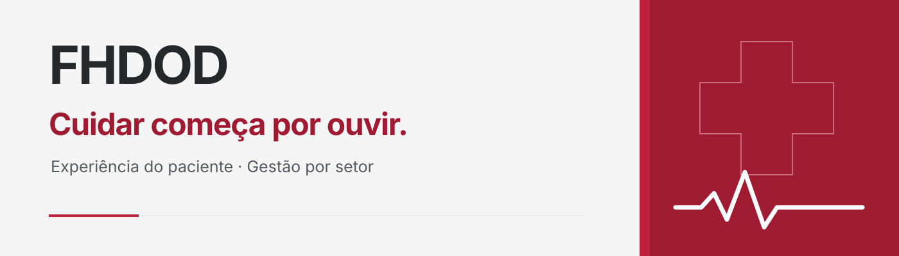
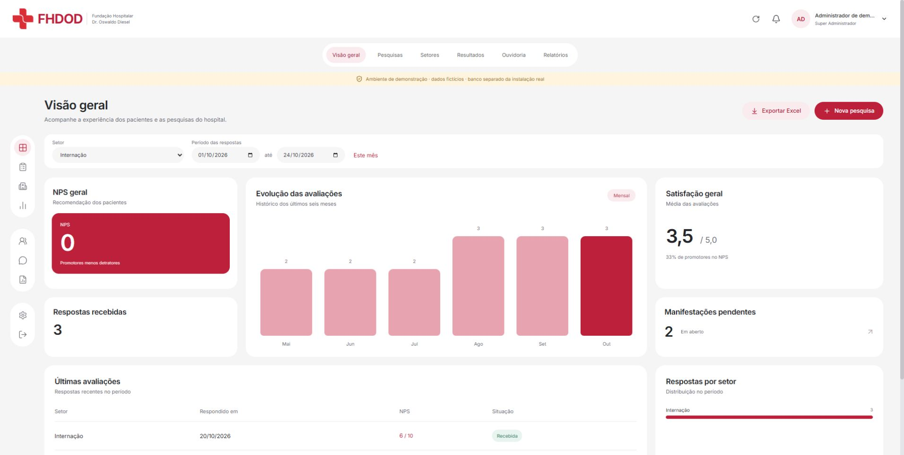
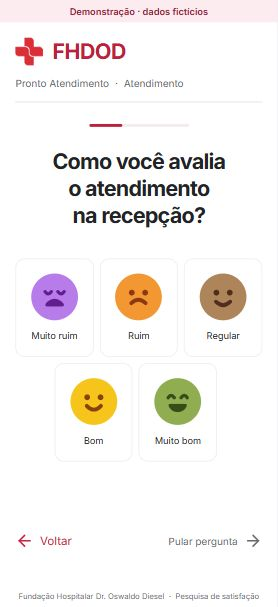
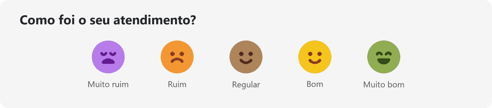

<p align="center">
  
</p>

<h1 align="center">FHDOD · Experiência do paciente</h1>

<p align="center">
  <strong>Escutar cada paciente. Acompanhar cada setor. Melhorar o cuidado.</strong><br>
  Pesquisas de satisfação e gestão da experiência hospitalar.<br>
  <sub>🏥 Fundação Hospitalar Dr. Oswaldo Diesel · Em desenvolvimento · Execução local</sub>
</p>

<p align="center">
  <a href="#o-projeto">O projeto</a> ·
  <a href="#telas">Telas</a> ·
  <a href="#instalacao">Instalação</a> ·
  <a href="#acessos">Acessos</a> ·
  <a href="#documentacao">Documentação</a>
</p>

<p align="center">
  
</p>

<p align="center">
  
</p>

<a name="o-projeto"></a>

## ❤️ O projeto

O **FHDOD** organiza a escuta dos pacientes em uma pesquisa digital por setor. As respostas alimentam indicadores e manifestações que ajudam a equipe a acompanhar a experiência de atendimento.

| 🫶 Para quem responde | 🏥 Para cada setor | 📊 Para a gestão |
| --- | --- | --- |
| Questionário sem login, uma pergunta por tela e avaliações com carinhas. | Um administrador próprio, perguntas do setor e acesso às suas respostas. | Indicadores, filtros e acompanhamento dos setores conforme as permissões. |

<p align="center">
  <strong>Cada resposta ajuda a cuidar.</strong><br>
  <picture>
    
  </picture><br>
</p>


### O que já está funcionando

- **🔗 Pesquisa por setor:** URL pública e QR Code para responder pelo celular ou tablet.
- **💬 Escuta simples:** uma pergunta por tela; somente a nota NPS, de 0 a 10, é obrigatória.
- **🕒 Registro da experiência:** salvamento parcial, horário de cada resposta e data de atendimento separada.
- **📋 Formulários próprios:** perguntas configuráveis por setor, com versões que preservam o significado das respostas anteriores.
- **📈 Acompanhamento:** indicadores, filtros por período e setor e exportação XLSX conforme o perfil.
- **🤝 Ouvidoria:** manifestações com situação, notas internas e histórico próprios.
- **🔐 Acesso definido por função:** cinco perfis, permissões aplicadas na API e registro de auditoria.

Após o envio confirmado, a tela de agradecimento retorna ao início em **10 segundos por padrão**. O Super Admin pode ajustar esse tempo; o botão **Finalizar** permite voltar antes.

<a name="telas"></a>

## 🖥️ Conheça as telas

> As capturas abaixo são do **ambiente de demonstração, com dados fictícios**.

### Painel administrativo

Indicadores, avaliações e acompanhamento da experiência do paciente em uma visão por setor e período.

[](docs/assets/painel-administrativo.jpg)

### Questionário do paciente

Controles maiores, rótulos legíveis e cinco expressões para avaliar o atendimento. As demais perguntas podem ser puladas; apenas o NPS é obrigatório.

<p align="center">
  <a href="docs/assets/questionario-paciente.jpg">
    
  </a>
</p>

<p align="center">
  <br>
  <sub>Cada avaliação faz parte da escuta. Ilustração de apresentação, sem dados de pacientes.</sub>
</p>

## 🩺 Como a experiência acontece

| Etapa | No sistema |
| --- | --- |
| **1 · Acessar** | O paciente abre o link ou o QR Code do setor, sem precisar entrar com uma conta. |
| **2 · Responder** | Informa o contexto do atendimento, se souber, e responde uma pergunta por vez. |
| **3 · Recomendar** | Escolhe uma nota NPS de 0 a 10, a única resposta obrigatória. |
| **4 · Compartilhar** | Pode deixar um comentário e solicitar retorno da ouvidoria. |
| **5 · Acompanhar** | A equipe consulta os registros, os indicadores e as manifestações conforme seu acesso. |

<a name="instalacao"></a>

## 🚀 Comece por aqui

**Requisitos:** Node.js **24 ou superior**, npm e Git.

```sh
git clone https://github.com/FelipeOldenburg/FHDOD.git
cd FHDOD
npm install
npm run dev
```

Abra **[http://127.0.0.1:5173](http://127.0.0.1:5173)**.

O Vite encaminha `/api` para a API em `127.0.0.1:3001`. O banco padrão fica em `data/fhdod.sqlite`.

### Primeiro acesso

1. Abra a aplicação localmente e informe nome, e-mail e senha temporária para criar o **Super Admin**.
2. Use uma senha de **12 a 128 caracteres**. A troca é obrigatória antes de acessar o painel, inclusive para o Super Admin.
3. Cadastre os setores e seus administradores pela tela **Setores**.
4. Configure as perguntas e compartilhe a URL ou o QR Code do questionário com os pacientes.

**Não existem credenciais fixas.** A configuração inicial exige acesso local ao servidor. O paciente usa uma URL no formato `/avaliar/<slug-do-setor>`, sem login administrativo.

<details>
<summary><strong>🧪 Explorar com dados fictícios</strong></summary>

Encerre a execução anterior e use:

```sh
npm run dev:demo
```

Esse modo usa **`data/demo.sqlite`**, separado do banco padrão, e identifica a demonstração na interface. Também exige a criação do primeiro administrador.

**Atenção ao banco escolhido:** `FHDOD_DB` substitui o caminho padrão inclusive no modo demo. Não aponte essa variável para dados reais ao usar a demonstração.

</details>

<details>
<summary><strong>📦 Executar o build local</strong></summary>

```sh
npm run build
npm start
```

Abra **[http://127.0.0.1:3001](http://127.0.0.1:3001)**. A API serve os arquivos gerados em `dist/`.

Os servidores escutam somente no endereço local.

</details>

<a name="acessos"></a>

## 🔑 Acessos e responsabilidades

| Perfil | Responsabilidade |
| --- | --- |
| **Super Admin** | Administra usuários, setores, configurações e pesquisas; acompanha todos os setores. |
| **Admin de Setor** | Um único login por setor, com acesso às perguntas e respostas daquele setor. |
| **Gestão** | Consulta indicadores dos setores associados à conta. |
| **Ouvidoria** | Acompanha manifestações e contatos dos setores autorizados. |
| **Visualizador** | Consulta indicadores dos setores associados à conta. |

### Cadastro e recuperação de acesso

- Na tela **Setores**, o Super Admin informa o setor e o e-mail do administrador. A API cria o setor e a conta juntos; se houver erro, nenhum dos dois é salvo.
- A senha temporária aparece **uma única vez** e deve ser trocada no primeiro login. Setores antigos sem conta ficam pendentes de configuração, sem credenciais preenchidas automaticamente.
- Super Admin e Admin de Setor usam a **mesma tela de login**. A conta autenticada define as permissões.
- Desativar a conta ou o setor bloqueia o acesso e as sessões existentes. Redefinir a senha também invalida as sessões anteriores.
- A tela **Usuários** administra os demais perfis e permite editar acessos. O perfil e o vínculo de um Admin de Setor válido permanecem fixos; vínculos antigos incorretos podem ser corrigidos sem excluir respostas.

**Os registros originais são preservados:** respostas enviadas e comentários dos pacientes não podem ser alterados pelos administradores, incluindo o Super Admin. A ouvidoria trabalha com suas próprias notas e seu histórico.

## 🛠️ Tecnologia e organização

| Camada | Implementação |
| --- | --- |
| **Interface** | React 19, TypeScript 7 e Vite 8. |
| **API** | Node.js, servidor HTTP e permissões aplicadas no servidor. |
| **Persistência** | SQLite local com `node:sqlite`. |
| **Interface visual** | Inter local, ícones Lucide e marca institucional. |
| **Exportação** | ExcelJS carregado sob demanda para gerar XLSX no navegador. |
| **Verificações** | Testes integrados com o executor nativo do Node.js. |

```text
FHDOD/
├── docs/assets/      # Imagens e animações deste README
├── public/assets/    # Marca usada na aplicação
├── scripts/          # Inicialização do ambiente local
├── server/           # API, banco e testes integrados
├── src/              # Painel e questionário em React
├── DESIGN.md         # Identidade visual e componentes
├── PRODUCT.md        # Contexto e limites do produto
└── README.md         # Apresentação e instruções de uso
```

<details>
<summary><strong>⚙️ Variáveis de ambiente</strong></summary>

As variáveis são lidas do **ambiente do processo**; o servidor **não carrega arquivos `.env` automaticamente**.

| Variável | Uso |
| --- | --- |
| `FHDOD_DB` | Caminho alternativo do SQLite; substitui o padrão, inclusive no demo. |
| `FHDOD_DEMO=1` | Ativa a demonstração; `dev:demo` já configura essa variável. |
| `PORT` | Porta da API, com padrão `3001`. O proxy do Vite está configurado para `3001`. |
| `FHDOD_ORIGIN` | Origem adicional aceita na proteção contra requisições entre sites. |
| `FHDOD_COOKIE_SECURE=1` | Exige HTTPS para envio do cookie de sessão. |

O banco local, os arquivos de ambiente e as dependências instaladas ficam fora do versionamento.

</details>

<details>
<summary><strong>✅ Comandos e cobertura dos testes</strong></summary>

```sh
npm test
```

Os testes integrados cobrem os cinco perfis, isolamento de setores, troca e redefinição de senha, preservação de respostas e versões, indicadores, NPS, distribuição das avaliações, proteção contra requisições entre sites, datas em São Paulo e auditoria de exportações.

| Comando | Finalidade |
| --- | --- |
| `npm run dev` | Iniciar o ambiente local de desenvolvimento. |
| `npm run dev:demo` | Iniciar com dados fictícios em banco separado. |
| `npm run build` | Verificar os tipos e gerar o build da interface. |
| `npm start` | Servir o build local pela API. |
| `npm test` | Executar os testes integrados. |

O override de `uuid` mantém a correção da dependência transitiva usada pelo ExcelJS sem reduzir sua versão.

</details>

<a name="documentacao"></a>

## 📚 Documentação e próximos passos

- **[Contexto do produto](PRODUCT.md):** usuários, objetivos, regras e decisões em aberto.
- **[Sistema visual](DESIGN.md):** cores, tipografia, componentes e comportamento da interface.
- **[Referência no Figma](https://www.figma.com/design/KarxSPvzNUwEGQgLbMbhB2):** base visual fornecida para o projeto.
- **[Histórico do desenvolvimento](https://github.com/FelipeOldenburg/FHDOD/commits/main/):** evolução do projeto por alteração.

### Em desenvolvimento

Esta é uma implementação para execução local. Os itens abaixo **ainda não estão implementados**:

- [ ] Importação de escalas e associação a profissionais.
- [ ] TV Wall para acompanhamento dos indicadores.
- [ ] Backup e retenção conforme a política institucional.
- [ ] HTTPS e hospedagem.
- [ ] Envio automático de e-mails.
- [ ] Relatórios em PDF.

<details>
<summary><strong>🎨 Créditos visuais e imagens</strong></summary>

A marca em `public/assets/fhdod-logo.png` veio do **[site oficial da FHDOD](https://www.fhdod.com.br/images/logo.png)** e foi preservada. A inspeção do Figma ocorreu pelo navegador: o conector exigia acesso de editor e não forneceu automaticamente contexto nem assets.

As carinhas da interface são SVGs recriados por aproximação da referência de avaliação enviada durante o desenvolvimento. As capas, os símbolos e os GIFs deste README são gráficos de apresentação, sem representar dados clínicos ou resultados reais. As duas capturas da aplicação usam dados fictícios.

O GIF de pulso é o arquivo **Gigaton Sticker by Pearl Jam.gif**, fornecido para este README e preservado sem alterações.

As imagens ficam no próprio repositório. A animação do pulso se repete e tem uma versão estática para leitura com menos movimento; a animação de avaliações é breve e não se repete.

</details>

---

<p align="center">
  <strong>🏥 Cuidar começa por ouvir.</strong><br>
  <sub>Fundação Hospitalar Dr. Oswaldo Diesel · Experiência do paciente</sub>
</p>
